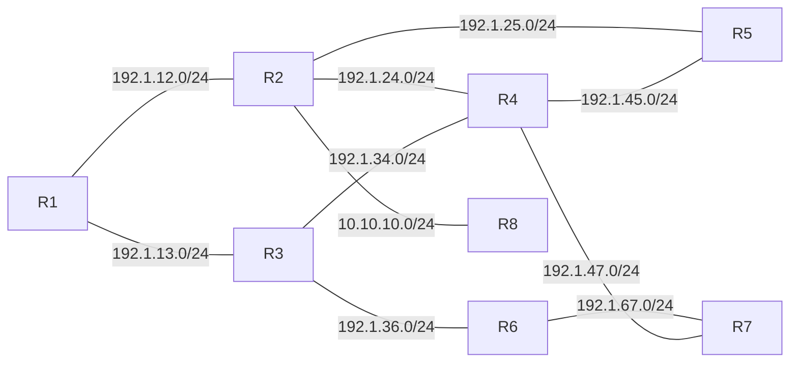

# EIGRP Lab (GNS3)

An 8-router EIGRP lab built in GNS3 on Cisco 7200 routers, using both classic and named-mode EIGRP.

## Topology

Every router also advertises four or more loopback networks.

## Lab tasks

- Basic configuration on physical interfaces and loopbacks
- Named-mode EIGRP (R1)
- Passive interfaces
- Offset list (R5)
- Authentication (R1–R2, R3–R6)
- Static default route (R8)
- Routing between different EIGRP autonomous systems
- Route filtering with an access list (R2)

## What the saved configs show

- Classic EIGRP AS 11 on R2–R5, R7 and R8
- Named-mode EIGRP (`address-family ipv4 autonomous-system 11`) on R1 and R6
- Passive interfaces configured on every router

The configs saved here are from the base build. See the LinkedIn post for the full lab walkthrough.

## Files

| File | Contents |
|---|---|
| `eigrp/eigrp.gns3` | GNS3 project |
| `EIGRP TASKS.pdf` | Lab task sheet |
| `eigrp-configuration-commands.txt` | Command log of the configuration |

| Router | Config |
|---|---|
| R1 | [`i1_startup-config.cfg`](eigrp/project-files/dynamips/e5621d86-f1bb-434d-82f4-86bd265a7922/configs/i1_startup-config.cfg) |
| R2 | [`i2_startup-config.cfg`](eigrp/project-files/dynamips/e1aa3f63-799d-4933-a02a-a5880f64df1b/configs/i2_startup-config.cfg) |
| R3 | [`i3_startup-config.cfg`](eigrp/project-files/dynamips/8cbb8310-1ba3-4580-8e4a-f28d7da35efa/configs/i3_startup-config.cfg) |
| R4 | [`i4_startup-config.cfg`](eigrp/project-files/dynamips/6202412a-e9fd-4c82-bddb-72cfb4e07834/configs/i4_startup-config.cfg) |
| R5 | [`i5_startup-config.cfg`](eigrp/project-files/dynamips/bfb2b910-e3c3-48e1-80e1-64cb318a6c37/configs/i5_startup-config.cfg) |
| R6 | [`i6_startup-config.cfg`](eigrp/project-files/dynamips/eb590bb7-bf61-4565-80ca-f57b19dd0774/configs/i6_startup-config.cfg) |
| R7 | [`i7_startup-config.cfg`](eigrp/project-files/dynamips/6972cbb1-1ac2-49f5-a462-43c01b10e00f/configs/i7_startup-config.cfg) |
| R8 | [`i8_startup-config.cfg`](eigrp/project-files/dynamips/e68f1085-24f1-4e15-9d64-4be6e7dcdadd/configs/i8_startup-config.cfg) |

Lab write-up on LinkedIn: [EIGRP lab post](https://www.linkedin.com/feed/update/urn:li:activity:7323007238678179841/)

Thanks to Eng. Mohamed El Hady.
